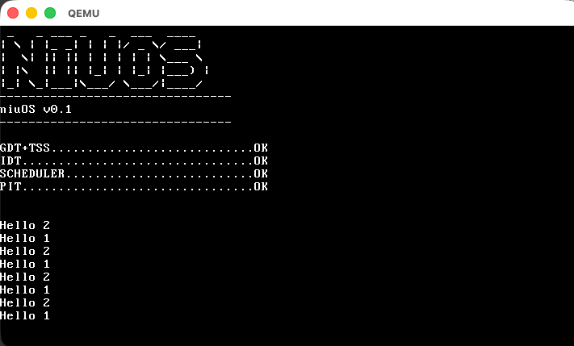

# niuOS

A minimal x86_32 kernel built from scratch for learning purposes, designed to run under QEMU on macOS.

Tested on:
- macOS Tahoe 26.5.1
- Apple M1 Max (ARM)

### Requirements

Install the toolchain via Homebrew:

```bash
brew install i686-elf-gcc i686-elf-binutils nasm qemu
```

## Run it

```bash
make
make run
```

This produces the `os-image.bin` file and it will run ```qemu-system-i386 -drive format=raw,file=os-image.bin``` 



## Current features

- Loads the MBR and kernel on boot
- GDT and IDT initialization
- Interrupt handlers:
    - Keyboard
    - PIT (timer)
    - Syscalls 
        * SYS_EXIT
        * SYS_FORK
        * SYS_READ
        * SYS_WRITE
        * SYS_OPEN
        * SYS_SEEK
        * SYS_BRK
        * SYS_WAITPID
        * SYS_WAIT
        * SYS_EXECVE
        * SYS_PIPE
        * SYS_STAT
        * SYS_GETDENTS64
- Preemptive scheduler
- Two fixed userland processes (`hello1`, `hello2`) registered with the scheduler, each just calling a syscall to print a character

## Architecture notes

### GDT / IDT sizing

- **GDT**: 3 descriptors × 8 bytes = 24 bytes. Every GDT/IDT descriptor on x86 is always 8 bytes, whether it describes code, data, or an interrupt.
- **IDT**: 256 entries × 8 bytes = 2048 bytes (2 KB). Only one entry is actually used (`0x21`), but the table reserves space for all 256 because the hardware indexes directly by vector number — there's no way to have "fewer" entries.

### Where they live in memory

- The **GDT** lives inside the boot sector itself: it's written directly in `boot.asm`, so its 24 bytes travel within the 512 bytes loaded at `0x7C00`. It isn't "loaded" from anywhere — it's already in RAM because the BIOS placed the whole sector there.
- The **IDT** lives inside the kernel's `.bss` section (uninitialized memory): the `idt[256]` array lands at `0x14640`. That's `0x10000` (kernel load address) + `0x4640` — right after the 16 KB stack reserved in `kernel_entry.asm`.

### GDTR / IDTR only point to the tables

The CPU has two dedicated internal registers, GDTR and IDTR (48 bits: a limit plus a 32-bit base address). `lgdt` and `lidt` only load these pointers — the table itself always lives in ordinary RAM, never "inside" the CPU. On every interrupt or segment-selector use, the CPU fetches the descriptor from RAM at that moment.

### Memory map

```
0x00000000 ┌──────────────────────────────────────┐
           │ Real-mode IVT (BIOS)  (256×4B = 1KB)  │  <- irrelevant once lidt runs
0x00000400 ├──────────────────────────────────────┤
           │ BIOS Data Area                        │
           │            ...                        │
           │ (real-mode stack: SP=0x7C00, grows    │
           │  downward, toward here)               │
0x00007C00 ├──────────────────────────────────────┤
           │ MBR (boot.bin) - 512 bytes            │
           │  - real-mode code                     │
           │  - GDT (24 bytes) <-- gdt_start       │
           │  - 55AA signature at byte 511         │
0x00007E00 ├──────────────────────────────────────┤
           │ free                                  │
0x00010000 ├──────────────────────────────────────┤
           │ KERNEL (kernel.bin), loaded via        │
           │ int13h/AH=42h from disk                │
           │  0x10000  _start (kernel_entry.asm)    │
           │  0x10010  irq1 (isr.asm)                │
           │  .text: kmain, screen_*, idt_init,      │
           │         keyboard_handler...             │
           │  .bss:                                  │
           │    kernel stack (16KB)                  │
           │    0x14640  idt[256]  <-- 2048 bytes     │
           │    idtp, cursor_row, cursor_col...       │
0x00020000 ├──────────────────────────────────────┤
           │ hello1 (tasks[0]), loaded via boot.asm │
           │  0x20000  _start (crt0.asm)              │
0x00030000 ├──────────────────────────────────────┤
           │ hello2 (tasks[1]), loaded via boot.asm │
           │  0x30000  _start (crt0.asm)              │
0x00090000 ├──────────────────────────────────────┤
           │ protected-mode stack top (ESP)          │
           │ grows downward                          │
0x000A0000 ├──────────────────────────────────────┤
           │ video memory (0xB8000 = VGA text mode)  │
0x000C0000 ├──────────────────────────────────────┤
           │ BIOS ROM, etc.                          │
0x00100000 └──────────────────────────────────────┘  (1 MB - end of addressable low memory)
```